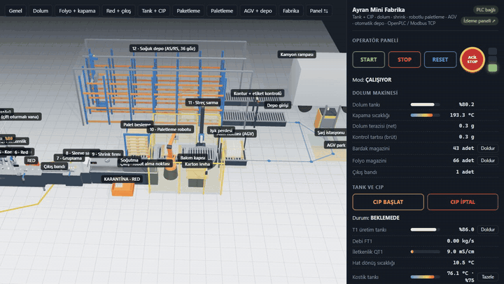
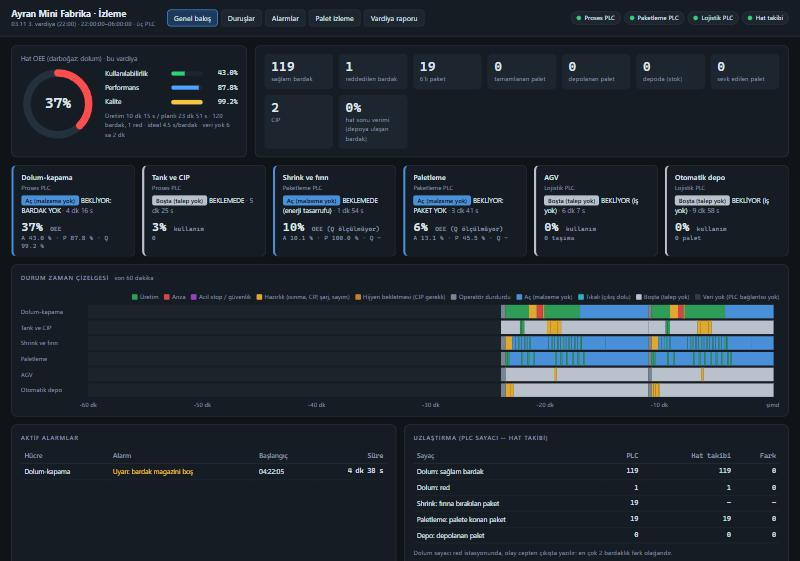
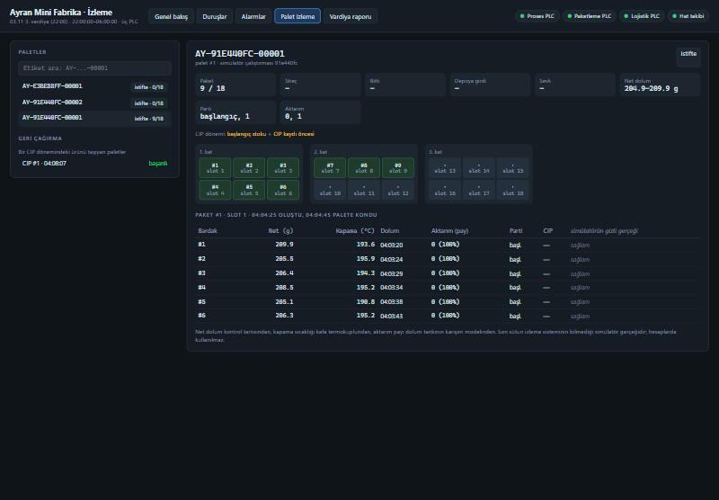
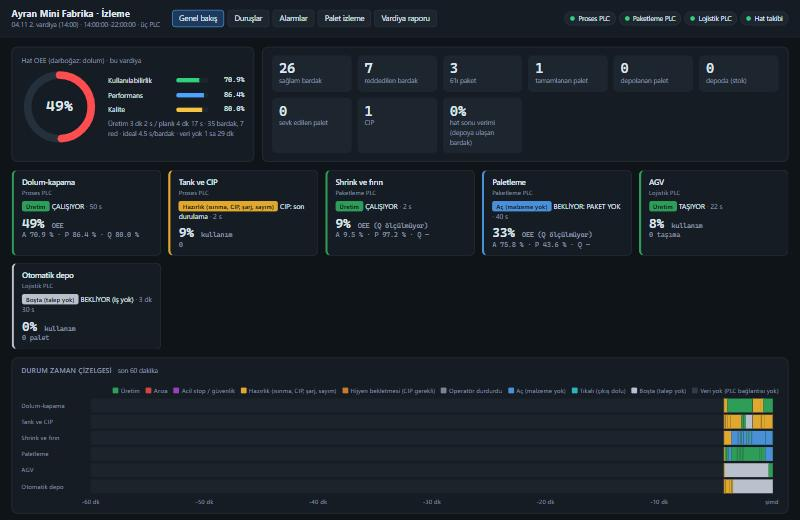
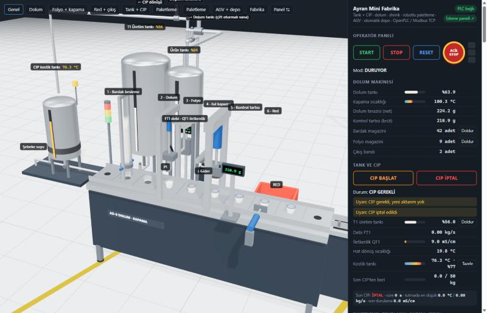
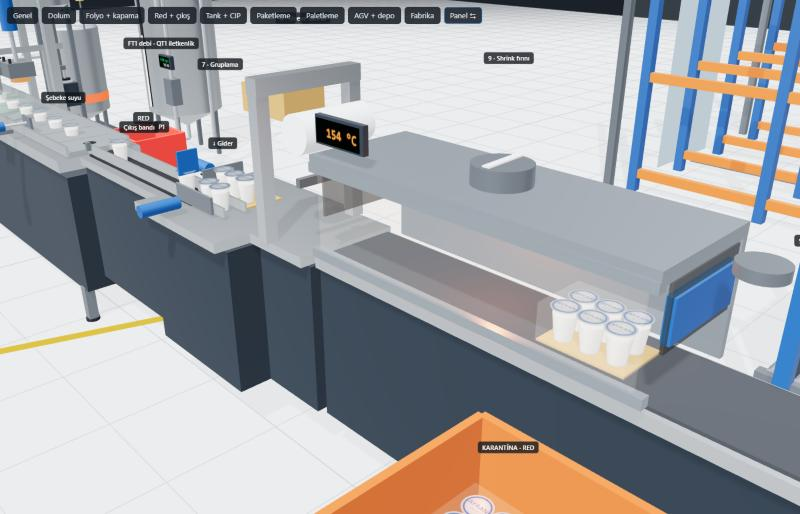

# Ayran Mini Fabrika Simülasyonu

**Gerçek PLC koduyla yönetilen 3B ayran fabrikası:** tanktan bardağa, paletten soğuk depoya ve kamyona.

*A 3D yogurt-drink (ayran) factory driven by real IEC 61131-3 PLC code over Modbus TCP: CIP, filling, shrink wrapping, robotic palletizing, AGV and an automated cold store. It runs on OpenPLC v3 (as three separate PLCs) and on CODESYS Control Win V3, survives PLC power loss without losing track of product, and has an MES-style monitoring layer with traceability and OEE.*



*Kayıt: hat CODESYS Control Win V3 yazılım PLC'siyle çalışıyor. Sırasıyla fabrikanın tamamı, dolum makinesi ve paletleme robotu.*

## Öne çıkanlar

- **Tam bir hat, altı hücre:** tank ve CIP temizliği, 8 cepli dolum-kapama makinesi, 6'lı shrink paketleme, robotlu paletleme ve streç sarma, AGV, 36 gözlü otomatik soğuk depo (AS/RS).
- **Gerçek PLC programı:** Kontrol mantığı IEC 61131-3 Structured Text ile yazıldı. Simülatör sahadaki sensör ve motorlar gibi davranır; PLC'ye Modbus TCP ile bağlanır.
- **İki gerçek çalışma ortamında denendi:** OpenPLC v3, tek PLC olarak ve proses / paketleme / lojistik diye üç ayrı PLC olarak. Ayrıca sanayide yaygın CODESYS Control Win V3.
- **Elektrik kesintisine dayanıklı:**
  - PLC açılışta hiçbir şeyi hareket ettirmez, operatörden START bekler.
  - Paletteki paket sayısı kalıcı bellekte tutulur ve robotun kendi kaydıyla doğrulanır.
  - Kesinti anında fırında kalan ürün karantinaya ayrılır.
  - Tank yeniden temizlik (CIP) ister.
- **İzleme katmanı (SCADA/MES benzeri):**
  - İzlenebilirlik zinciri: palet etiketi → paket → bardak → dolum ağırlığı → ürün partisi → son CIP.
  - Hücre başına OEE, duruş nedenleri, alarm geçmişi ve Pareto.
- **Arıza senaryoları:** Arayüzden 37 arıza eklenebilir (sıkışan piston, kopan film, robot çarpışması, AGV yolunda insan, Modbus kablosu kopması…). PLC'nin tepkisi alarm ve hücre durumlarından canlı izlenir.
- **217 otomatik test:** 96 arıza ve akış senaryosu, yeniden başlama ve izleme birim testleri.

## Hızlı deneme

```bash
npm install
npm run demo
```

3B fabrika http://localhost:8080 adresinde, izleme paneli http://localhost:8081 adresinde açılır. Demo, PLC programının JavaScript karşılığıyla çalışır; gerçek PLC ile çalıştırma aşağıda anlatılıyor. Node.js 22.13 veya üstü gerekir.

## Projede öğrenilenler

- **Ağ gecikmesi kontrolü bozar.** Dolum vanasının kapanma payı Modbus gecikmesiyle salınıyordu: bir fazla, bir eksik dolum. PLC görev süresi 20 ms'den 10 ms'ye inince red oranı düştü.
- **Kısa darbeler kaybolur.** 0,5 s'lik Modbus turunda bir taramalık sinyal görünmeyebilir. Robot, AGV ve depo vinciyle iş numaralı el sıkışma kullanıldı: aynı iş iki kez çalışmaz, sonuç kaydı kalıcıdır.
- **"Güç geri geldi" ayrı bir durumdur.** PLC belleği ile sahadaki gerçek durum farklı olabilir. Açılışta önce sensörler okunur, kayıtlar uzlaştırılır, sonra START beklenir.
- **Hücre sözleşmeleri karmaşıklığı böler.** Her makine yalnız komşusunun sinyallerini bilir. Bu sayede tek PLC'lik program sonradan proses, paketleme ve lojistik diye üç PLC'ye bölünebildi; hücreler arası sinyaller Modbus üzerinden taşındı.

## Genel bakış

Bir ayran fabrikasının 3B simülasyonu. Fabrikayı gerçek bir PLC programı yönetir: simülatör Modbus TCP sunucusu (slave) gibi davranır, OpenPLC ya da başka bir PLC istemci (master) olarak bağlanır.

Şu an fabrikada altı parça var:
- tank ve transfer hattı (CIP temizliğiyle birlikte),
- 8 cepli, endeksli bir dolum-kapama makinesi ve çıkış biriktirme bandı,
- 6'lı gruplama, sleeve shrink sarma ve shrink fırını,
- robotlu paletleme hücresi: 4 eksenli robot, palet hattı, streç sarma, çit, kapı ve ışık perdesi,
- otonom istif aracı (AGV): dolu paleti paletleme hücresinden depoya taşır, şarj olur,
- otomatik soğuk depo (AS/RS): 36 göz, istif vinci, giriş kontrolü, FIFO sevkiyat ve kamyon rampası.

Üstünde bir **izleme katmanı** (SCADA/MES benzeri) var: palet etiketinden bardağa, dolum ağırlığına, ürün partisine ve son CIP'e kadar izlenebilirlik; hücre başına OEE, duruş nedenleri, alarm geçmişi ve Pareto, vardiya raporu. Fabrika tek bir PLC ile ya da **üç PLC** ile (proses / paketleme / lojistik) yönetilebilir. Her istasyon kendi PLC fonksiyon bloğuna ve 16 register'lık Modbus bloğuna sahip.

```
 Simülatör (saha) ──Modbus──► Proses PLC     (dolum + tank, blok 0-2)  ──┐
   │  hat takip olayları ───► Paketleme PLC  (shrink + palet, blok 3-4) ─┼─Modbus (PLC'nin kendi slave'i)─► İzleme servisi ─► SQLite ─► panel
   │                      ──► Lojistik PLC   (AGV + depo, blok 5-6)    ──┘                                       ▲
   └────────────── /api/events (kimlikli ürün hareketleri: bardak, paket, palet, göz, sevkiyat) ─────────────────┘
```

```
 T1 üretim tankı ──V_PROD──┐                                    ┌──V_FILL (çift oturmalı)──► dolum tankı
 Su ───────────────V_WATER─┼──► P1 pompa ──► FT1 debi ──► QT1 ──┼──V_DRAIN──► gider
 CIP kostik tankı ─V_CAUSTIC┘                 iletkenlik        └──V_CIPRET──► kostik tankına dönüş

 Dolum makinesi:
 Bardak      Dolum         Folyo     Isıl       Kontrol    Red       Çıkış
 besleme     (terazili)              kapama     tartısı
  [0]   [1]    [2]          [3]       [4]        [5]        [6]   [7] ──►
   ▲            │            ▲         │          │          │
 magazin     kaba+ince    vakum kolu  195 °C    brüt tartı  piston → red kutusu
             akış                     0,8 s
```

## Ne gösteriyor

- **Endeksli çevrim ve paralel istasyonlar:** Zincir bir adım ilerler, altı istasyon aynı anda çalışır, hepsi bitince yeni adım atılır.
- **Ürün takibi (kaydırmalı kayıt):** Her cep için "bardak var / hatalı" bilgisi zincirle birlikte kaydırılır. Red kararı 4 cep sonra, doğru bardağa uygulanır.
- **Terazili iki kademeli dolum, iki öğrenen parametreyle:** Kaba akış, ardından ince akış.
  - Uçuş payı (pre-act): her bardaktan sonra son hatanın yarısı kadar düzeltilir.
  - Kaba akış kesme noktası: ince akış 0,5 s'den kısa sürerse kaba akış hedefi aşmış demektir, pay 10 g büyür; 2,5 s'den uzun sürerse 2 g küçülür.
  - Böylece program 20 ms'lik gecikmede de, OpenPLC v3'ün ~0,5 s'lik Modbus gidiş-dönüşünde de ±4 g toleransı tutturur.
- **Isıtıcı termostatı:** ±2 °C histerezis, ısınma beklemesi, 45 s'de ısınmazsa rezistans arızası alarmı.
- **Hücre sözleşmesi:** Dolum makinesi tankı %40'ın altına inince ürün ister, %80'de bırakır. Vanaları ve pompayı tank istasyonu yönetir; dolum makinesi tankın iç düzenini bilmez.
- **Rota yöneticisi ve karışmaz hat:** Her rota değişiminde pompa durur, yeni rotada olmayan bütün vanaların kapalı olduğu sınır anahtarlarıyla kanıtlanır, yeni rota açılır, vana strok süresi beklenir, pompa yeniden kalkar. Rotada olmayan bir vana açık görünürse pompa durur. Dolum tankı vanası çift oturmalı (mix-proof): conta kaçırırsa sıvı kaçak odasından gidere akar ve sensör alarm verir. Kostik ürüne geçemez.
- **Hat doldurma (push-out) ve faz ayırma:** Hattaki su ya da bayat ürün, iletkenlik ürün penceresine (8,5–9,5 mS/cm, 25 °C'ye düzeltilmiş) girene kadar gidere gider. CIP'te kostik, derişimi yeterli olana kadar gidere, sonra kostik tankına döner.
- **CIP:** hazırlık → kostik ısınması → ön durulama (30 kg su) → kostik (65 mS/cm, 70 °C ve 1,5 kg/s birlikte 30 s; biri düşerse süre baştan başlar) → son durulama (30 kg ve iletkenlik giriş suyu + 0,5 mS/cm'e inene kadar). Her CIP'in kaydı tutulur: sonuç, süre, tutma penceresindeki en düşük sıcaklık ve debi, son durulama iletkenliği. Süreler demo ölçeğindedir (gerçekte kostik temas süresi 10–20 dakika).
- **CIP planlama:** 50 kg üretimde bir CIP gerekir. Sınırda aktarım durur, dolum makinesi kendi tamponuyla bir süre devam eder.
- **Gruplama:** Şerit 3 bardakla dolunca giriş kapısı kapanır, kapı kapandıktan sonra sıra iticisi bardakları karton altlığın üstüne iter. Sıra ancak itici geri gelince sayılır. İki sıra olunca grup iticisi 2x3'lük paketi sarma makinesine iter.
- **Sarma:** İstek "bitti" sinyali gelene kadar tutulur (kısa darbe 0,5 s Modbus gecikmesinde kaybolabilir). Film koparsa alarm verilir; film değiştirilip reset yapılınca yarım kalan paket yeniden sarılır.
- **Shrink fırını:**
  - 160 °C (POF film), ±3 °C termostat. Paket ancak fırın sıcaksa, çıkış boşsa ve bant dönüyorsa fırına bırakılır.
  - Fan dönmüyorsa ya da bağımsız aşırı sıcaklık kesmesi attıysa ısıtıcı çalışmaz.
  - 2 dakika bardak gelmezse ayar değeri 120 °C'ye iner (enerji tasarrufu); yeni bardak gelince tekrar ısınır.
- **Kontrollü boşaltma:** Stop basılınca fırına yeni paket girmez, içerideki paketler çıkarılır, sonra fan fırını 60 °C'ye kadar soğutup durur. Çıkış tıkalıyken fırında paket varsa ısıtıcı hemen kesilir.
- **Paket sayımı:** Fotosel darbeleri gecikmede kaçabileceği için simülatör fırın giriş/çıkış sayaçları verir. PLC aradaki farktan içerideki paket sayısını, 15 s'dir çıkış olmuyorsa "paket sıkıştı" alarmını hesaplar.
- **Açılışta ürün karantinası:** İlk geçerli görüntüde fırında, sarıcıda veya plakada ürün varsa PLC kesilen grubu karantinaya boşaltır. Yeni grup oluşturulmaz; tek sıralı plaka ikinci sırayla tamamlanıp birlikte reddedilir. Fırın çıkış ayırıcısı yalnız PLC'nin `EXIT_PASS` veya `EXIT_REJECT` komutunu uygular; komutsuzken kapalıdır. Ürün sıcaklığı ve `simDefect` karara girmez. Red paketi robota ulaşmaz, `PAL_COUNT` artmaz; `packsRejected`/`cupsQuarantined` ayrı tutulur, fiziksel kayıp sayılmaz. Karantina sırasında tekrar PLC açılışı sensörlerden aynı kararı yeniden kurar.
- **Hücre durumu (PackML benzeri):** paket alabilir, çalışıyor, ısınıyor, boşaltıyor, arıza, çıkış tıkalı, bardak bekliyor bitleri ayrı bir kelimede yayınlanır (OEE için).
- **Robot ile iş el sıkışması:** PLC robotu eksen eksen sürmez; gerçek hücrelerdeki gibi robot kontrolcüsüne iş gönderir (al, bırak, karton levha, eve dön). İş numarası (SEQ) değişince iş başlar, aynı numara ikinci kez çalışmaz. Robot kabul ettiği ve bitirdiği işin numarasını, sonuç kodunu ve slotunu geri yazar; bu kayıt kalıcıdır, haberleşme kopup gelse de PLC son sonucu okuyabilir. Zaman aşımında iş körlemesine tekrarlanmaz, alarm verilir.
- **Paletteki paketlerin defteri:** 800×600 yarım palete 3 kat × 6 paket (2×3, aynı yönde sütun istif, alt ve üst karton). Paket sayısı yalnızca robot "tamam" ya da "bıraktım, sonra iş kesildi" dedikten sonra artar. Düşen paketin slotu boş kalır, sıradaki paket oraya konur. Testler her saniye PLC'nin sayısını paletteki gerçek paketlerle karşılaştırır.
- **Bölge kilidi:** Robot palet bölgesine ancak PLC'nin giriş izniyle (palet yerinde, pim yukarıda) girer. Dolu palet ancak robot bölgenin dışındayken ve iş yokken çıkarılır. Robot izin olmadan gelen işi reddeder.
- **Bağımsız güvenlik kontrolcüsü:** Kapı kilidi, ışık perdesi + muting ve acil stop, simülatördeki ayrı bir güvenlik kontrolcüsünde (gerçekte güvenlik rölesi ya da güvenlik PLC'si) değerlendirilir. Robot gücünü ve hücre motorlarını o keser; OpenPLC yalnızca durumunu okur. Palet perdeden geçerken muting perdeyi köprüler (12 s sınırıyla); palet yokken biri geçerse hücre durur. Reset hareket başlatmaz, ayrıca Start gerekir. Bu bir eğitim modelidir, sertifikalı bir güvenlik tasarımı değildir.
- **Streç sarma:** Döner tabla 9 tur sarar (3 alt, 2 çıkış, 2 üst, 2 iniş). İstek "bitti" gelene kadar tutulur. Film koparsa alarm verilir, film değişip reset ve Start sonrası palet baştan sarılır. PLC bitişte tur sayısını kontrol eder.
- **AGV ve istasyon el sıkışması:** PLC basit bir ana kontrol gibi AGV'ye iş verir (taşı, yükü bırak, şarj, park); araç kendi yolunu bulur. İstasyon izni (palet hazır, konveyör duruyor) yük alınana ya da bırakılana kadar tutulur. Araç "çatallar istasyonun dışında" bilgisini verir; çatallar içerideyken o istasyonun konveyörü çalışmaz. Lazer tarayıcı aracın kendisindedir: engelde durur, alan 2 s boş kalınca devam eder. Bu arayüz VDA 5050 değildir; o, filo yönetimi ve farklı üreticiler için gerekir.
- **Depo girişi:** Kontur (sarım, üst karton) ve etiket kontrolü. Geçemeyen palet depolanmaz, ret lambası yanar, operatör alır; kimliksiz stok oluşmaz.
- **Göz tablosu ve envanter uzlaştırma:** PLC her göz için durum (boş, ayrıldı, dolu, belirsiz) ve palet numarası tutar. Gerçek durum simülatördedir; PLC tablosu beklenen envanterdir. Yarım kalan iş, çift depolama ya da PLC'nin yeniden başlaması gözü "belirsiz" yapar; vinç gider, çatal okuyucusuyla etiketi okur ve tabloyu düzeltir. Tablo kalıcı olmadığı için PLC her açılışta envanter sayımı yapar. Çift depolamayı vinç fiziksel olarak da engeller: dolu göze çatal uzatmaz.
- **Yerleşim ve sevkiyat:** Yeni palet en alt kata, P&D'ye en yakın göze konur. Sevkiyat FIFO'dur (en eski palet numarası önce); bütün paletlerin raf ömrü aynı olduğu için FEFO ile aynı sonucu verir, gerçek FEFO için lot ve son kullanma tarihi gerekir. Sevk sayacı ancak palet kamyona yüklenince artar.
- **Soğuk depo:** 2–6 °C. Soğutma arızasında sıcaklık 6 °C'yi 30 s aşınca uyarı verilir; koridor kapısı açık kaldıkça depo ısınır.
- **Güvenlik ve izleme:** Acil stop zinciri (NC), stop butonu (NC), haberleşme kalp atışı bekçisi, her hareket için zaman aşımı alarmları, alarm onayı ve korna.
- **Arıza ekleme:** Arayüzden 37 farklı arıza açılabilir. Simülatör her bardağın, paketin ve paletin gerçek kalitesini (dolum, kapama, su ile seyrelme, kostik bulaşması, film, eksik paket, karton, sarım) ve hattın gizli kir skorunu ayrıca ölçer. Böylece PLC programının hatalı ürünü kaçırıp kaçırmadığı ya da kirli hattan ürün geçirip geçirmediği görülür.

## İzleme katmanı (aşama 5)

Tasarım ve inceleme kararları: [`../FAZ5-TASARIM.md`](docs/tasarim/FAZ5-TASARIM.md).

### Veri nereden geliyor

| Veri | Kaynak | Gerçek tesisteki karşılığı |
|---|---|---|
| Hücre durumu, alarm kelimeleri, üretim sayaçları, CIP kaydı | **PLC'nin kendi Modbus slave'i** (OpenPLC v3: port 502, `%QW100..` = holding register 100..). JS PLC aynı eşlemeyle 5030–5033'te slave açar. | SCADA/historian PLC'yi yoklar |
| Kimlikli ürün hareketleri: bardak (kontrol tartısı, kapama sıcaklığı, hangi aktarımdan dolduğu), paket, robotun koyduğu slot, palet, depo gözü, sevkiyat | **Simülatörün hat takip olay akışı** `GET /api/events?after=<seq>` | Kontrol tartısı, etiket yazıcısı, robot kontrolcüsü, palet okuyucu, WMS |

Kural: izleme veritabanına yalnızca sahada ölçülebilen bilgi girer. Simülatörün gizli gerçeği (`sim_defect`) ayrı sütunda durur, panelde gri gösterilir, hesaplara girmez; testler izleme sisteminin neyi kaçırdığını onunla ölçer.

Olay akışı halka tampondur: sıra numarası (`seq`), simülatörün her açılışında yeni `run` kimliği, en az bir kez teslim (kayıtlar `(run, numara)` anahtarlı, işleyiciler tekrar çalışınca aynı sonucu verir), tampon taşarsa `ingest_gap` kaydı. Gerçek bir ayran hattında bardaklar seri numaralı değildir; bardak düzeyi izleme burada "dijital ikiz" düzeyindedir. Gerçek karşılığı konumsal takiptir: `inferPackCups` paketin bardaklarını kimlik okumadan sıradan çıkarır ve testler bu çıkarımın kimlikli izlemeyle ne kadar tuttuğunu ölçer.

### İzlenebilirlik

- **Palet → paket → bardak → aktarım → parti → CIP:** palet etiketi (`AY-<run>-00012`) ile sorgulanır. Dolum tankı tam karışmış tank olarak modellenir; her bardak hangi aktarımlardan, hangi payla dolduğunu taşır (%0,5 altı yok sayılır).
- **"Bu palette hangi CIP'ten sonraki ürün var?"** Aktarımın CIP'i ilişki olarak saklanmaz, sorguda hesaplanır: aktarım başlamadan önce biten son CIP. Dolum makinesi CIP boyunca tampon tanktan ürettiği için bir palet iki dönemin ürününü birlikte taşıyabilir; panel bunu gösterir.
- **Geri çağırma (ileri yön):** bir CIP döneminin ya da bir partinin ürününü taşıyan paletler ve şu anki yerleri (istifte, depoda göz 14, sevk edildi, sipariş 3).
- **Uzlaştırma:** PLC sayaçları ile hat takip olayları aynı sayım noktasından karşılaştırılır (dolum sayacı red istasyonunda, olay cepten çıkışta yazıldığı için en çok 2 bardaklık fark olağandır).

### OEE

- Payda vardiya süresidir (takvim); yalnızca **VERI_YOK** (PLC'ye ulaşılamayan ya da izlemenin kapalı olduğu süre) düşülür. Operatörün STOP'u ve shrink'in enerji tasarrufu beklemesi kayıptır, planlı duruş değildir.
- Durum → kategori eşlemesi `iomap.js`'de (tek kaynak): Üretim, Arıza, Güvenlik, Hazırlık (ısınma, CIP, şarj, envanter sayımı), Hijyen (CIP gerekli), Operatör durdurdu, Aç (malzeme yok, dış kaynaklı), Tıkalı (çıkış dolu, dış kaynaklı), Boşta (talep yok), Veri yok.
- Dolum makinesi artık "ürün yok" (7) ve "bardak yok" (8) durumlarını yayınlar; önceden bu süreler "çalışıyor" görünüyordu.
- Dolum: ideal 4,5 s/bardak, kalite PLC'nin red sayacından. Shrink (8 s/paket) ve paletleme (4,5 s/paket) için red mekanizması yok: kalite "ölçülmüyor", OEE "A × P (Q yok)" diye gösterilir. Tank, AGV ve depo için OEE yerine kullanım oranı.
- Hat OEE'si darboğazın (dolum) OEE'sidir; yanında "hat sonu verimi" (depoya ulaşan paletlerdeki bardak / dolan bardak) gösterilir.
- Mikro duruş: üretimdeyken adet 3 ideal çevrimden uzun gelmezse (ilk adet hat dolumudur, sayılmaz). Performans kaybının alt kalemidir.
- PLC oturum sayaçları 0..30000, shrink ayırıcı sayaçları 0..29999 sarar; izleme azalmayı fark yarım turdan büyükse sarma, değilse PLC yeniden başlaması sayar (`counter_reset`). Sayaç durumu veritabanında tutulur, izleme servisi yeniden başlasa da fark kaybolmaz. Shrink izleme adedi `GOOD + REJECT` ile aynı fiziksel çıkış noktasından hesaplanır; `PACKS` ayrıca fırına bırakma oturum sayacı olarak kalır.
- Bir veri boşluğunu (PLC'ye ulaşılamadı, izleme kapalıydı) kapsayan sayaç farkı uzlaştırmaya girer ama OEE'ye girmez (o sürenin çalışma zamanı bilinmiyor; "gözlenmeyen üretim" olarak ayrıca raporlanır).
- CIP bitişi, CIP'in en son görüldüğü an olarak yazılır (aktarım CIP sırasında başlayamadığı için ürün bağlamak için güvenli); bitiş bir veri boşluğuna denk gelirse "belirsiz" işaretlenir. Yarım kalan CIP izi veritabanında tutulur.
- Gözlem: OpenPLC v3 gecikmesinde (100 ms yoklama + 100 ms gecikme) dolum çevrimi ~6 s'ye uzar; bu, panelde performans kaybı olarak görünür (20 ms yoklamada P ≈ %95, v3 gecikmesinde ≈ %75).

### Gösterge paneli







`npm run demo` ile birlikte http://localhost:8081 adresinde açılır (3B arayüzün sağ üstünde "İzleme paneli" bağlantısı). Harici kütüphane yok, SVG ile çizilir, 2 s'de bir yenilenir.

- **Genel bakış:** hat OEE'si (A/P/Q), sayaçlar, hücre kartları (şu anki durum ve ne zamandır, OEE ya da kullanım), son 60 dakikanın durum zaman çizelgesi, aktif alarmlar, uzlaştırma.
- **Duruşlar:** hücre başına kategori dağılımı (15 dk / 1 saat / vardiya), dolum kayıp ağacı (süre ve kayıp adet, kendi / dış kaynaklı), en uzun duruşlar.
- **Alarmlar:** Pareto (adet + birikimli %, %80 çizgisi), geçmiş.
- **Palet izleme:** etiket arama, palet kartı (durum, göz, sevkiyat, net dolum aralığı, parti, aktarım, CIP dönemi), 3 katlık slot ızgarası, pakete tıklayınca bardaklar; CIP seçince geri çağırma listesi.
- **Vardiya raporu:** yazdırılabilir (OEE, üretim, ilk 5 alarm, en uzun duruşlar, CIP'ler, veri kalitesi).

API (JSON): `/api/overview`, `/api/timeline`, `/api/stops`, `/api/alarms`, `/api/pallets`, `/api/trace?label=`, `/api/recall?cip=`, `/api/cips`, `/api/lots`, `/api/report`.

### Üç PLC

| PLC | Bloklar | Okuma (FC4) | Yazma (FC16) | Kalp atışı |
|---|---|---|---|---|
| Proses | 1 dolum, 2 tank (+ blok 0'ın sahibi) | IR 0–47 | HR 0–47 | `FAB_QW_PLC_HB` |
| Paketleme | 3 shrink, 4 paletleme | IR 0–79 | HR 48–79 | `SHR_QW_PLC_HB` |
| Lojistik | 5 AGV, 6 depo | IR 0–111 | HR 80–111 | `AGV_QW_PLC_HB` |
| Tek PLC | hepsi | IR 0–111 | HR 0–111 | üçü de |

- Kaynak tek: `plc/src/Ortak.st` (panel, bekçi), `Proses.st`, `Paketleme.st`, `Lojistik.st`. `npm run build:plc` dört dosya üretir: `plc/build/fabrika.st` (tek PLC, hepsi tek PROGRAM'da) ve `proses.st`, `paketleme.st`, `lojistik.st`. `%IW/%QW` adresleri rolün okuma/yazma başlangıcına göre hesaplanır (OpenPLC slave cihazı `%QW100`'ü yazma aralığının ilk register'ına eşler).
- Simülatörün bekçisi PLC başınadır: bir PLC'nin kalp atışı 1,5 s değişmezse yalnızca o PLC'nin hücrelerinin çıkışları düşer; diğerleri aç ya da tıkalı kalıp zarar görmeden bekler.
- PLC sınırını aşan iki sinyal var (paketleme ↔ lojistik):
  - "Alım noktasında palet hazır": paketleme PLC'sinin `PAL_QW_DO` bit 11 çıkışı simülatörde kabloyla lojistik PLC'sinin `AGV_IW_IL` girişine gelir; paketleme PLC'si düşerse kablo 0 okur. Tek PLC modunda FB'den FB'ye doğrudan bağlanır.
  - "AGV çatalları dışarıda": aracın istasyona verdiği optik sinyal, istasyonun kendi girişi `PAL_IW_IL` (PLC üzerinden geçmez).
- Harita sürümü 7: önceki giriş/çıkış adresleri korunur. Çıkış ayırıcısı `SHR_IW_DIVERT` (IR 57), fiziksel red sayacı `SHR_IW_REJECT_CNT` (IR 58), PLC red/geçiş sayaçları `SHR_QW_REJECT` (HR 55) ve `SHR_QW_GOOD` (HR 56) eklendi. Shrink DO bit 9 geçiş, bit 10 red; STATUS bit 8 karantina. Bütün hücrelerde STATUS bit 7 yeniden açılışta START beklendiğini gösterir. Aynı `%MW32..43` şemasındaki sağlam v6 defter, checksum ve saha/robot doğrulaması sonrası sayısı korunarak v7'ye geçirilir; bozuk kayıt göç ettirilmez.
- Demo: `npm run demo:3plc` (üç JS PLC + izleme, izleme üçünü kendi slave portlarından okur). Ayrı süreçler için `node plc/js-plc.js --role proses` vb.

Yeniden başlama (aşama 6a): her PLC açılışta otomatik hareketlerini kapatır ve yeni START bekler. Robot bu sırada HOLD altındadır. Kabul edilmiş iş (ACK, RES'in bir sonrasında; 30000→1 sarması dahil) START ve B pimi geri bildirimi sonrası aynı numarayla devam eder; terminal sonuç kalıcı defterle uzlaştırılmadan yeni iş verilmez. İşsiz robotta READY/ACK=RES ve B varsa PIN_UP, 500 ms doğrulanır; tutucuda paket varsa koyma, referans yoksa eve dönüş seçilir. Ev konumunda ve tutucunun boş olması şart değildir. Shrink plakasındaki sıralar sensörden okunur; dolu plakaya sıra itilmez. Palet defteri program düzeyindeki `%MW` alanında checksum ve UNDERWRAP uyarısıyla saklanır, robotun kalıcı sonuç kaydıyla doğrulanır; en fazla bir iş bayat terminal kayıt onarılır ve ardından kabul edilmiş işin sonucu beklenebilir. Bellek yoksa veya doğrulanamazsa paletleme alarm verir, START ve robot işi kilitlenir. El ile alma düğmesi bilinmeyen B paletini AGV yoluna sokmadan kaldırır; defteri kendiliğinden sıfırlamaz. Ara konumda durmuş paletler operatör müdahalesi gerektirebilir. OpenPLC program yüklemesi kalıcı dosyayı siler; `run_ayran.sh` saklama aralığını 1 saniye yapar. Tank her normal açılışta yeni CIP ister; yalnızca test düzeneği ve `npm run demo` (simülatörü temiz hatla birlikte başlatır, `startPlc({ commission: true })`) bunun dışındadır. Tasarım: [FAZ6-KALICI-BELLEK.md](docs/tasarim/FAZ6-KALICI-BELLEK.md); uygulama ve dört inceleme turu: [FAZ6-KOD-RAPOR-CODEX.md](docs/tasarim/FAZ6-KOD-RAPOR-CODEX.md). Karantinaya ayrılan ürün için kalan sınır: plakada bekleyen, fırına hiç girmemiş bardaklar da temkinli olarak karantinaya gider.





## Hızlı başlangıç

Node.js 22.13 veya üstü gerekir (izleme katmanı yerleşik `node:sqlite` kullanır).

```bash
npm install
npm run demo
```

8080 portu doluysa (örneğin WSL'deki OpenPLC kullanıyorsa) başka port verin: `PORT=8086 MODBUS_PORT=5021 MON_PORT=8087 npm run demo` ya da `node scripts/demo.js --port 8086 --modbus 5021 --mon 8087`.

Tarayıcıda `http://localhost:8080` adresini açın, **START**'a basın. Isıtıcı yaklaşık 20 saniyede kapama sıcaklığına ulaşır, sonra üretim başlar. İzleme paneli: `http://localhost:8081`.

`npm run demo` simülatörü, programın JavaScript karşılığını (`plc/js-plc.js`) ve izleme servisini birlikte başlatır. İzleme servisi tek başına: `npm run monitor` (ayarlar `monitor/server.js` başındaki ortam değişkenlerinde). OpenPLC ile çalıştırmak için yalnızca simülatörü başlatın:

```bash
npm start
```

Kısayollar: `H` paneli gizler (video çekimi için), `1`–`9` kamera görünümlerini değiştirir (5: tank ve CIP, 6: paketleme, 7: paletleme, 8: AGV ve depo, 9: bütün fabrika). Paletleme panelindeki "Test besleyici" alma noktasına 5 s'de bir hazır paket koyar; hücreyi bir paletin dolmasını (~12 dakika) beklemeden göstermek için.

## OpenPLC ile çalıştırma

PLC kaynakları [`plc/src`](plc/src) klasöründedir:
- [`Ortak.st`](plc/src/Ortak.st): her PLC'de aynı bölüm. Operatör paneli, acil stop, haberleşme bekçisi, açılış biti, kalp atışı.
- [`Proses.st`](plc/src/Proses.st), [`Paketleme.st`](plc/src/Paketleme.st), [`Lojistik.st`](plc/src/Lojistik.st): rol programları (hangi FB'leri çağırdıkları, PLC'ler arası sinyaller, kalıcı `%MW` alanı).
- `FB_Dolum.st`, `FB_Tank.st`, `FB_Shrink.st`, `FB_Pallet.st`, `FB_Agv.st`, `FB_Asrs.st`: hücrelerin fonksiyon blokları; her birinin `plc/fb_*.js` satır satır JS karşılığı vardır.

OpenPLC tek dosya istediği için bunlar birleştirilir. Adres bildirimleri `public/iomap.js`'den üretilir, böylece simülatörle PLC'nin adresleri kaymaz:

```bash
npm run build:plc
```

Çıktı: `plc/build/fabrika.st` (tek PLC) ve üç PLC için `proses.st`, `paketleme.st`, `lojistik.st`. Üretici, matiec'i sessizce çökerten iki durumu da (ASCII dışı karakter, çok isimli TON listesi) yakalayıp hata verir.

### Üç gerçek OpenPLC (tek WSL makinesinde)

[`oplc3.sh`](plc/openplc/oplc3.sh) üç OpenPLC v3'ü aynı Linux/WSL makinesinde çalıştırır. Her biri kendi ağ alanındadır (Linux network namespace), dolayısıyla kendi 502 (Modbus slave), 8080 (web) ve 43628 (çekirdek) portları çakışmaz. Ana makinede 5501 / 5502 / 5503 portları sırasıyla proses / paketleme / lojistik OpenPLC'lerinin 502'sine yönlendirilir. OpenPLC'lerin simülatöre giden bağlantısı NAT ile çıkar. Gerekenler: `iproute2`, `iptables`.

```bash
sudo ./plc/openplc/oplc3.sh setup                # OpenPLC klasörünü rol başına kopyalar, ağ alanlarını ve NAT'ı kurar
sudo SIM_PORT=5022 ./plc/openplc/oplc3.sh load   # üç rolü derler ve yapılandırır (kalıcı bellek 1 s)
sudo ./plc/openplc/oplc3.sh start                # üçünü başlatır; restart <rol> tek birini yeniden başlatır
node scripts/oplc3-run.mjs 660                   # Windows'ta: simülatör + izleme, senaryo ve sonuç
```

`oplc3-run.mjs` simülatörü 8090/5022'de, izleme panelini 8094'te açar. Sırasıyla:
- RESET + START, tankın istediği CIP;
- üretim ve alma noktasına test paketleri;
- 200 s paketleme, 360 s proses (ardından CIP), 470 s lojistik OpenPLC'sini yeniden başlatır; her birinde START 45 s gecikir;
- sonunda 1 paletlik sevkiyat.

`OPLC3_PLAN="proses@150:cip"` ile plan değiştirilebilir. Sonuç `monitor/data/oplc3-result.json` dosyasına yazılır.

### CODESYS Control Win V3 (yazılım PLC, test edildi)

Aynı ST programı (tek PLC rolü) CODESYS 3.5 SP22 Patch 4 ile derlenip Windows'ta çalışan **CODESYS Control Win V3 x64** yazılım PLC'sine indirilir. PLC, ModbusFB kütüphanesiyle simülatöre Modbus TCP istemcisi olarak bağlanır (127.0.0.1:5020; IR 0+112 okur, HR 0+112 yazar). Modbus cihazı arayüzde tanımlanmaz, kodda yazılıdır ([`codesys/modbus-io.st`](codesys/modbus-io.st)). OpenPLC'ye özgü `%IW/%QW` adresleri düz değişken listesine, `%MW` kalıcı alanı `VAR_GLOBAL PERSISTENT` listesine çevrilir. Program mantığı değişmez.

```bash
npm run build:codesys          # plc/src → codesys/build/pous.json
```

Ardından PowerShell'de (CODESYS profil adı tırnaklı verilmeli):

```bash
& "C:\Program Files\CODESYS 3.5.22.40\CODESYS\Common\CODESYS.exe" --profile="CODESYS V3.5 SP22 Patch 4" --runscript="<proje>\codesys\create_project.py" --noUI
& "C:\Program Files\CODESYS 3.5.22.40\CODESYS\Common\CODESYS.exe" --profile="CODESYS V3.5 SP22 Patch 4" --runscript="<proje>\codesys\download_run.py" --noUI
```

- `create_project.py`: proje, Control Win cihazı, Standard + ModbusFB kütüphaneleri, POU'lar, 10 ms'lik görev ve derleme. Sonuç `codesys/build/build-result.json` ve `build-messages.txt` dosyalarına yazılır (hata satırlarıyla).
- `download_run.py`: yerel ağ geçidi (yoksa `localhost:1217` eklenir), cihaz taraması, indirme, RUN ve önyükleme uygulaması. PLC'de kullanıcı yönetimi açıksa betik kullanıcı adını ve şifreyi `CODESYS_USER` / `CODESYS_PASSWORD` ortam değişkenlerinden okur; yoksa görünmez kipte şifre penceresinde bekler. PowerShell'de çağrı `Start-Process -ArgumentList '...'` ile yapılmalı, yoksa profil adının tırnakları kaybolur.
- Önce Control Win başlatılmalı: sistem tepsisindeki CODESYS Control Win simgesi → "Start PLC" (yönetici izni ister). Deneme kipinde (lisanssız) çalışma süresi sınırlıdır.
- Kurulumda öğrenilenler:
  - Standard kütüphanesi betikle eklenince "yalnızca nitelikli ad" işaretli gelir; kapatılmazsa `TON` tanınmaz.
  - Kütüphane başvuruları proje kapatılıp açılınca çözülür.
  - Çağrı içinde dizi sabiti (`[127, 0, 0, 1]`) yazılamaz.

Sonuç (4 Kasım 2026): derleme 0 hata, 0 uyarı; indirme, RUN ve önyükleme uygulaması başarılı. RESET + START + CIP verildikten sonra 4 dakikada:
- CIP tamamlandı, 37 sağlam bardak üretildi, 5 paket palete kondu;
- alarm yok, PLC kalp atışı görev döngüsüyle düzenli arttı.

Dolum red oranı: 20 ms'lik görevde ilk ~50 bardakta dolum ağırlığı reddi yüksekti (ilk 60 bardakta ~9). Nedeni, dolum makinesinin vana kapanma ön ayarını (`preact`) öğrenirken G/Ç gecikmesi yüzünden salınması: bir fazla, bir eksik dolum. Öğrenme sonrası red %0,6 idi (337 bardakta 2). Bir Modbus turu okuma, sıfırlama, yazma ve sıfırlama adımlarıyla ~6 tarama sürdüğü için görev 10 ms'ye indirildi. Sonuç: yeniden indirmeden sonraki ilk 60 bardakta ağırlık kaynaklı 1 red; diğer 5 red, simülatörde folyo magazininin bitmesinden.

Yeniden başlama denemesi (CODESYS kalıcı belleği, 4 Kasım 2026): Hat çalışırken Control Win servisi durduruldu. O anda palette 14 paket vardı ve PLC defteri de 14 diyordu. PLC uzun süre kapalı kaldı, sonra servis yeniden başlatıldı.
- Açılışta PLC çalışır ama hiçbir şeyi hareket ettirmez: dolum, shrink ve paletleme "START bekliyor" (STATUS 0x80) durumunda. Tank "CIP GEREKLİ" durumunda, çünkü her açılışta yeni CIP isteniyor. Shrink karantina bayrağı (0x100) kalkık geldi. Depo envanter sayımı yaptı ve PLC tablosunu raflarla eşitledi (stok 4/36).
- `VAR_GLOBAL PERSISTENT` içindeki palet defteri 14 olarak geri geldi ve gerçek paket sayısıyla aynıydı.
- RESET + START + CIP sonrası 4 dakikada: CIP tamamlandı ve 55 sağlam bardak üretildi. 5. palet 18/18 ile kapandı (yeniden başlamadan önceki 14 + sonraki 4 paket). Yeni palete 3 paket kondu ve defter yine gerçek sayıyla aynıydı. Karantinaya 1 paket ayrıldı, kayıp bardak 0.
- Operatör işi: PLC kapalıyken AGV bekleme sırasında batarya harcar (%0,02/s). Şarj istasyonu ancak PLC'nin "AGV etkin" çıkışıyla şarj ettiği için batarya %0'a indi ve AGV alarma geçti. "Elle şarj" + RESET ile döndü. Gerçek tesiste şarj istasyonunun PLC'den bağımsız şarj etmesi bu durumu önler.

### OpenPLC Runtime v3 (test edildi)

Program OpenPLC v3'ün kendi derleyicisiyle (matiec + g++) derlendi ve simülatöre bağlanıp çalıştırıldı. Sonuçlar:

| Test | Sonuç |
|---|---|
| Normal üretim, ~3 dakika | 32 sağlam bardak, 0 hatalı sevk, 0 kayıp. Dolumlar 204,6–207,7 g. Yalnızca öğrenme sırasındaki ilk 2 bardak reddedildi. |
| Dolum terazisi +8 g kayar | Kontrol tartısı 11 eksik dolumu yakaladı, 0 hatalı sevk |
| Üretim ortasında acil stop | Acil stop modu ve alarm, reset sonrası ısınma beklemesi, üretime dönüş, 0 hatalı sevk |
| Fabrika yapısı (harita v2), çıkış bandı tıkanır | Bant 12 bardakla doldu, makine "çıkış dolu" modunda bekledi, 0 bardak ezildi; bant açılınca kendiliğinden devam etti |
| Tank: ilk aktarım | Push-out 7 kg ürünü gidere gönderdi (iletkenlik 9,0 mS/cm'e ulaşana kadar), sonra 25,8 kg dolum tankına aktarıldı |
| Tank: üretim sırasında CIP | Başarılı, 74 s. Tutmada en düşük 74,6 °C ve 1,52 kg/s, son durulama 0,4 mS/cm. Hat kir skoru 0. Dolum makinesi CIP boyunca tamponundan üretmeye devam etti. |
| Tank: dolum vanası açık takılı + CIP isteği | "Vana kapanmadı" alarmı, CIP başarısız, pompa hiç kalkmadı, ürüne 0 g kostik |
| Paketleme: ~3,5 dakika üretim | 5 sağlam paket, 0 hatalı. Fırın 159,8 °C'de. Bardak beklerken durum bitleri "paket alabilir + çalışıyor + bardak bekliyor". |
| Paketleme: fırında paket varken stop | Boşaltma durumuna geçti, bant 10 s içinde paketi çıkardı, sonra fan fırını 60 °C'ye soğutup durdu (~80 s); 0 hatalı paket |
| Paletleme: test besleyiciyle ~7 dakika, iş ortasında kapı açma ve bir kez vakum kaçağı | 2 sağlam palet (18 paket, alt/üst karton, 9 tur streç), 0 hatalı palet, 0 çarpışma. Kapı robot bırakırken açıldı: güvenlik durdurması, kapı + reset + start sonrası devam. Düşen paket sayılmadı, slotuna sonraki paket kondu. PLC sayısı paletteki gerçek paketlerle hiç ayrışmadı. 91 robot işi, al-bırak çevrimi ~3,8 s. |
| AGV + depo: test besleyiciyle ~8 dakika, vinç paleti taşırken koridor kapısı açılır, sonra 1 paletlik sipariş | Açılışta 36 gözlük envanter sayımı 44 s. AGV 2 paleti taşıdı, ikisi de depolandı. Kapı açılınca güvenlik durdurması; yarım kalan gözü vinç reset + start sonrası kontrol etti, çataldaki paleti yeni göze koydu. Sipariş en eski paleti (#1, FIFO) kamyona yükledi. PLC göz tablosu raftaki paletlerle hiç ayrışmadı; 0 çarpışma, 0 alarm. |
| Aşama 5, üç PLC karma: **paketleme PLC'si OpenPLC v3** (`ROLE=paketleme`, okuma 0+80, yazma 48+32), proses ve lojistik JS PLC; izleme servisi üçünü Modbus ile okur (OpenPLC'yi kendi 502 portundan). ~8 dakika, üretim + test besleyici, sonra 1 paletlik sipariş | Dört ST dosyası da (tek, proses, paketleme, lojistik) OpenPLC'nin derleyicisinde derlendi. Üç PLC'nin bekçisi tüm süre canlı, 0 haberleşme boşluğu. OpenPLC'nin istiflediği 2 palet PLC'ler arası kabloyla AGV'ye verildi, depolandı, biri sevk edildi; 0 çarpışma, 0 hatalı palet, 0 kayıp bardak. Uzlaştırma: palete konan 43 paket ve depolanan 2 palet PLC sayaçları ile hat takibinde aynı; dolumda 91/89 (sayım noktası farkı). İzlemeden OEE: dolum A %97, P %87; paletleme A %86. Not: simülatör tarafındaki anlık defter karşılaştırması örneklerin %10'unda farklı çıktı; fark palet değişiminde OpenPLC'nin sayacı Modbus gecikmesiyle geç sıfırlamasından geliyor (çarpışma olmadı). |
| Aşama 6a, yeniden başlama: **paketleme PLC'si OpenPLC v3**, kalıcı bellek açık (`Pstorage_polling` 1 s), proses ve lojistik JS PLC. 520 s üretim + test besleyici; 150 s ve 290 s'de `systemctl restart openplc` (program yeniden yüklenir, `%MW` dosyadan gelir), 6 s sonra START (`scripts/openplc-restart.mjs`) | İlk denemede bulunan iki hata (robot işin ortasındayken kalıcı kilit / alarmsız bekleme; yeniden başlamada fırında kalan paketin ısınıp iyi palete gitmesi) düzeltildi. Son deneme: START öncesi 0 hareket; palet sayısı iki açılışta da gerçekle aynı (15; robotun yarım koyma işi kaydıyla 10 → 11 uzlaştı); fırın/plakadaki 2 paket (12 bardak) karantinaya ayrıldı, PLC red sayacı 2; 2 palet hatasız depolandı; 0 kayıp bardak, 0 çarpışma, 0 hatalı palet. |
| Aşama 6a, **üç PLC'nin üçü de gerçek OpenPLC v3** (`oplc3.sh`, tek WSL'de üç ağ alanı; izleme üçünü Modbus ile okur), 660 s: temiz açılışta CIP, üretim + test besleyici, paketleme / proses / lojistik OpenPLC'si sırayla yeniden başlatıldı (START 45 s sonra), sonra sevkiyat | Üç PLC'nin bekçisi tüm süre canlı; 6 haberleşme boşluğu, yalnız bilerek yapılan yeniden başlatmalar (her biri ≤ 1,2 s). 2 palet hatasız depolandı, 1'i sevk edildi; paketleme açılışında fırındaki 1 paket karantinaya ayrıldı; tank 2 CIP (ikisi de başarılı, proses açılışında yarım kalan CIP iptal sayıldı); lojistik açılışında AGV yüklü taşıdığı paleti depoya teslim etti. 0 kayıp bardak, 0 çarpışma, 0 hatalı palet. Uzlaştırma: palete konan 48/48 paket, depolanan 2/2 palet, karantina 1/1. **Bulunan hata:** proses açılışında 45 s START beklemesinde dolum ısıtıcısı (çıkış maskeli) soğudu, ısınma bekçisi iç komuta baktığı için sahte "Isıtıcı ısınmıyor" alarmı verdi ve dolum durdu. Bekçi artık yalnız gerçekten sürülen ısıtıcıyı sayar (ST + JS, birim testi). Düzeltmeden sonra aynı proses açılışı tekrarlandı: alarm yok, dolum START sonrası ısınıp üretime döndü, palet hatasız depolandı. |

#### Windows'ta WSL ile tek komutta kurulum

```powershell
wsl --install -d Ubuntu-24.04 --no-launch
```

Ubuntu içinde (root olarak: `wsl -d Ubuntu-24.04 -u root`):

```bash
git clone --depth 1 https://github.com/thiagoralves/OpenPLC_v3.git ~/OpenPLC_v3
cd ~/OpenPLC_v3 && ./install.sh linux
```

Kurulum 15–25 dakika sürer. Ardından simülatörü Windows'ta `npm start` ile başlatın ve Ubuntu'da şunu çalıştırın:

```bash
./plc/openplc/run_ayran.sh
```

[`run_ayran.sh`](plc/openplc/run_ayran.sh) web arayüzüne girmeden programı derler, simülatörü slave cihaz olarak tanımlar (Windows adresini WSL ağ geçidinden kendisi bulur) ve PLC'yi RUN modunda başlatır.

Üç PLC'li fabrikada bu OpenPLC'nin rolü `ROLE` ile seçilir; dosya ve slave aralıkları buna göre yazılır, diğer roller JS PLC olarak çalışır:

```bash
ROLE=paketleme ./plc/openplc/run_ayran.sh          # OpenPLC = paketleme PLC'si
node plc/js-plc.js --role proses                   # Windows'ta
node plc/js-plc.js --role lojistik
MON_MODE=bolunmus MON_PLCS=paketleme=<WSL IP>:502 npm run monitor
```

`NO_START=1` derleyip yapılandırır ama başlatmaz (systemd servisi varsa `systemctl restart openplc`).

Dikkat edilecekler:
- OpenPLC kurulumu bir systemd servisi ekler. Servis zaten çalışıyorsa `run_ayran.sh` sonrası `systemctl restart openplc` yeterlidir.
- WSL, açık oturum kalmayınca Ubuntu'yu birkaç saniyede kapatır ve PLC durur. Test sırasında bir Ubuntu terminali açık tutun.
- OpenPLC web arayüzü WSL'de 8080 portunu alır. Simülatörü başka portta açın: `PORT=8090 npm start` (PowerShell'de `$env:PORT=8090; npm start`).
- matiec (OpenPLC'nin ST derleyicisi) iki durumda hata mesajı vermeden çöker: yorumlarda Türkçe karakter olduğunda ve uzun bir TON listesi tek satırda bildirildiğinde. Programdaki yorumlar bu yüzden ASCII'dir ve her zamanlayıcı ayrı satırdadır.
- `STEP` ve `RS` IEC 61131-3'te ayrılmış sözcüklerdir (SFC adımı, RS flip-flop); değişken adı olarak kullanılamaz. `npm run build:plc` bu üç durumu da derlemeden önce yakalar.

#### Web arayüzüyle elle kurulum

1. **Programs → Upload Program** ile `plc/build/fabrika.st` dosyasını yükleyip derleyin.
2. **Slave Devices → Add new device**:
   - Device type: Generic Modbus TCP Device
   - Slave ID: 1
   - IP: simülatörün çalıştığı bilgisayar. WSL'den Windows'a `ip route show default` çıktısındaki ağ geçidi adresi kullanılır. OpenPLC Docker'daysa `host.docker.internal` kullanılır.
   - Port: 5020
   - Input Registers (%IW100): start 0, size 112
   - Holding Registers - Write (%QW100): start 0, size 112 (üç PLC için rol başına aralıklar: "Üç PLC" tablosu)
   - Diğer alanlar: size 0
3. **Start PLC**. Simülatör panelinde "PLC bağlı" görünür.

### OpenPLC v4 (Editor + Runtime v4)

1. `plc/build/fabrika.st` içindeki fonksiyon bloklarını ve programı editöre aktarın (`CONFIGURATION` bloğu hariç).
2. **Remote Device → Modbus TCP** ekleyin: IP, port 5020, Slave ID 1.
3. I/O grupları:
   - FC 4 (Read Input Registers), offset 0, length 112
   - FC 6 (Write Single Register): v4 blok yazmayı (FC 16) desteklemez, her register ayrı grup ister. Zorunlu olanlar: 1 (PLC kalp atışı) ve 16 (dolum çıkış kelimesi). 0, 2, 3 ve 17–20 yalnızca panel göstergeleri içindir.
4. Programdaki `AT %IW…` ve `AT %QW…` adreslerini editörün **Address** sütununda gördüğünüz adreslerle değiştirin.

v4'ün varsayılan 100 ms yoklama süresini taklit etmek için: `node plc/js-plc.js --v4`.

### Başka bir PLC

Herhangi bir Modbus TCP master bağlanabilir (Siemens S7 MB_CLIENT, CODESYS Modbus TCP Master vb.). Simülatör her Slave ID'yi kabul eder.

## Sinyal haritası (sürüm 7)

Tek kaynak: [`public/iomap.js`](public/iomap.js). Simülatör, arayüz, JS test PLC'si ve ST üreticisi aynı dosyayı kullanır.

Her istasyona 16 register'lık bir blok ayrılmıştır. Input Register `blok×16 + n` simülatörden PLC'ye, Holding Register `blok×16 + n` PLC'den simülatöre gider. 7 blok (112 register) tek bir FC4 okuma ve tek bir FC16 yazma isteğine sığar. Dijital sinyaller 16 bitlik kelimelere paketlidir.

| Blok | Register | İstasyon | Durum |
|---|---|---|---|
| 0 | 0–15 | Fabrika: operatör paneli, acil stop, kalp atışları, harita sürümü | var |
| 1 | 16–31 | Dolum-kapama | var |
| 2 | 32–47 | Tank, pompa, flowmetre, CIP | var |
| 3 | 48–63 | Gruplama, shrink, fırın | var |
| 4 | 64–79 | Robotlu paletleme, palet hattı, streç | var |
| 5 | 80–95 | Otonom istif aracı (AGV) | var |
| 6 | 96–111 | Otomatik soğuk depo (AS/RS) | var |

### Blok 0: fabrika

| Adres | Yön | Etiket | İçerik |
|---|---|---|---|
| IR 0 | → PLC | FAB_IW_DI | Bit 0 START (NO), 1 STOP_OK (NC), 2 ESTOP_OK (NC), 3 RESET |
| IR 1 | → PLC | FAB_IW_MAPVER | Harita sürümü (7). Tutmazsa PLC girişleri geçersiz sayar. |
| IR 2 | → PLC | FAB_IW_SIM_HB | Simülatör kalp atışı (100 ms) |
| HR 0 | → sim | FAB_QW_DO | Bit 0: fabrika üretimde |
| HR 1 | → sim | FAB_QW_PLC_HB | PLC kalp atışı (her tarama). Simülatör 1,5 s değişmezse bütün çıkışları kapatır. |
| HR 2–3 | → sim | FAB_QW_STATE / ALARM | Fabrika durumu ve alarm özeti |

### Blok 1: dolum-kapama

| Adres | Etiket | İçerik |
|---|---|---|
| IR 16 | DOL_IW_DI | Bit 0 INDEX, 1 CUP_EMPTY, 2 CUP_AT_FILL, 3 NOZ_UP, 4 NOZ_DN, 5 FOIL_EMPTY, 6 FOIL_AT_SEAL, 7 SEAL_UP, 8 SEAL_DN, 9 TANK_LOW, 10 CUP_AT_REJ, 11 REJ_EXT, 12 OUT_FULL |
| IR 17 | DOL_IW_FILL | Dolum terazisi, net, 0,1 g |
| IR 18 | DOL_IW_TANK | Dolum tankı seviyesi, 0,1 % |
| IR 19 | DOL_IW_TEMP | Kapama kafası, 0,1 °C |
| IR 20 | DOL_IW_CHECK | Kontrol tartısı, brüt, 0,1 g |
| HR 16 | DOL_QW_DO | Bit 0 CONV, 1 CUP_DROP, 2 NOZ_DN, 3 FILL_FAST, 4 FILL_FINE, 5 FOIL, 6 SEAL_DN, 7 HEATER, 8 REJECT, 9 TANK_IN, 10 GREEN, 11 YELLOW, 12 RED, 13 HORN |
| HR 17 | DOL_QW_STATE | 0 duruyor, 1 çalışıyor, 2 çevrim sonunda duruyor, 3 alarm, 4 acil stop, 5 ısınıyor, 6 çıkış dolu (bekliyor) |
| HR 18 | DOL_QW_ALARM | Bit 0–7 alarmlar (acil stop, sıkışma, dolum ağzı, kapama kafası, folyo yok, ısıtıcı, red pistonu, haberleşme); 8–11 uyarılar |
| HR 19–20 | DOL_QW_GOOD / REJECT | Sayaçlar |

### Blok 2: tank, transfer, CIP

| Adres | Etiket | İçerik |
|---|---|---|
| IR 32 | TNK_IW_DI | Bit 0 T1_LOW, 1 CIP_START, 2 CIP_ABORT, 3 P1_RUN, 4 P1_TRIP, 5–10 vanaların "kapalı" sınır anahtarları (V_PROD, V_WATER, V_CAUSTIC, V_FILL, V_DRAIN, V_CIPRET), 11 VFILL_LEAK |
| IR 33 | TNK_IW_T1_LVL | Üretim tankı seviyesi, 0,1 % |
| IR 34 | TNK_IW_FLOW | Debi, 0,01 kg/s |
| IR 35 | TNK_IW_TOTAL | Debimetre toplayıcısı, 0,1 kg (30000'de sıfırlanır; PLC farkı sıfırlanmayı hesaba katarak alır) |
| IR 36 | TNK_IW_COND | İletkenlik, 0,1 mS/cm, 25 °C'ye düzeltilmiş |
| IR 37–39 | TNK_IW_RET_T / CIP_T / CIP_LVL | Dönüş sıcaklığı, kostik tankı sıcaklığı ve seviyesi |
| HR 32 | TNK_QW_DO | Bit 0 P1, 1 V_PROD, 2 V_WATER, 3 V_CAUSTIC, 4 V_FILL, 5 V_DRAIN, 6 V_CIPRET, 7 kostik ısıtıcısı, 8 CIP lambası |
| HR 33 | TNK_QW_STATE | 0 bekleme, 1 aktarım, 2 hat doldurma, 3 rota değişiyor, 4–8 CIP adımları, 9 CIP gerekli, 10 alarm, 11 acil stop |
| HR 34 | TNK_QW_ALARM | Bit 0–9 ve 13 alarmlar, 10–12 uyarılar (`TANK_ALARMS`) |
| HR 35–37 | STEP_T / SINCE / BATCH | Adım süresi, son CIP'ten beri ve bu aktarımda aktarılan miktar |
| HR 38–42 | CIP kaydı | Sonuç (1 başarılı, 2 iptal, 3 başarısız), en düşük sıcaklık, en düşük debi, son iletkenlik, süre |

### Blok 3: gruplama, sarma, fırın

| Adres | Etiket | İçerik |
|---|---|---|
| IR 48 | SHR_IW_DI | Bit 0 LANE_FULL, 1–2 sıra iticisi ileri/geri, 3–4 grup iticisi ileri/geri, 5 altlık var, 6 altlık azaldı, 7 sarma hazır, 8 sarma çalışıyor, 9 sarma bitti, 10 sarma arızası, 11 sarma makinesinde paket, 12 fan dönüyor, 13 bant dönüyor, 14 aşırı sıcaklık kesmesi, 15 çıkış dolu |
| IR 49 | SHR_IW_LANE | Şeritteki bardak sayısı |
| IR 50 | SHR_IW_TEMP | Fırın havası, 0,1 °C |
| IR 51–52 | IN_CNT / OUT_CNT | Fırın giriş ve çıkış paket sayaçları (30000'de sıfırlanır) |
| IR 53–55 | FILM / PADS / EXIT_CNT | Film bobini (0,1 %), altlık adedi, çıkıştan alınan paket sayacı |
| IR 56 | SHR_IW_PLATE | Bit 0/1: plakada birinci/ikinci sıra |
| IR 57 | SHR_IW_DIVERT | Bit 0 ayırıcıda paket, 1 red konumu, 2 geçiş konumu |
| IR 58 | SHR_IW_REJECT_CNT | Fiziksel red fotoseli sayacı (30000 modül) |
| HR 48 | SHR_QW_DO | Bit 0 kapı, 1 sıra iticisi, 2 grup iticisi, 3 altlık, 4 sarma isteği, 5 bırak, 6 fırın bandı, 7 ısıtıcı, 8 fan, 9 EXIT_PASS, 10 EXIT_REJECT |
| HR 49 | SHR_QW_STATE | 0 duruyor, 1 ısınıyor, 2 çalışıyor, 3 bardak bekliyor, 4 çıkış dolu, 5 boşaltıyor, 6 soğutuyor, 7 enerji tasarrufu, 8 alarm, 9 acil stop |
| HR 50 | SHR_QW_ALARM | `SHRINK_ALARMS` |
| HR 51 | SHR_QW_STATUS | Bit 0 paket alabilir, 1 çalışıyor, 2 ısınıyor, 3 boşaltıyor, 4 arıza, 5 çıkış tıkalı, 6 bardak bekliyor, 7 açılış START beklemesi, 8 karantina |
| HR 52–54 | PACKS / INSIDE / SP | Fırına bırakılan paket, fırındaki paket, geçerli ayar değeri |
| HR 55–56 | REJECT / GOOD | Karantina ve iyi ürün bandına geçiş sayaçları (30000 modül); izleme aynı çıkış noktasını sayar |

### Blok 4: robotlu paletleme

| Adres | Etiket | İçerik |
|---|---|---|
| IR 64 | PAL_IW_DI | Bit 0 alma noktasında paket, 1–4 A/B/C/D konumlarında palet, 5 pim yukarıda, 6 besleyici çalışıyor, 7 tabla başlangıçta, 8 streç çalışıyor, 9 streç bitti, 10 streç arızası, 11 güvenlik tamam, 12 kapı kapalı, 13 perde serbest, 14 muting, 15 güvenlik resetlenmeye hazır |
| IR 65 | PAL_IW_ROB_DI | Robot: 0 enerjili, 1 iş alabilir, 2 iş sürüyor, 3 bekleme konumunda, 4 palet bölgesinin dışında, 5 tutucuda parça, 6 vakum, 7 hata, 8 duraklatıldı, 9 konumu doğrulanmış |
| IR 66–69 | ACK_SEQ / RES_SEQ / RES_CODE / RES_SLOT | Kabul edilen ve biten son iş; sonuç 1 tamam, 10 parça yok, 11 düşürdü, 12 reddedildi, 13 iptal, 14 çarpışma, 15 levha yok, 16 bölge izni yok, 17 bıraktı sonra iptal |
| IR 70–73 | TURNS / PALLETS / SHEETS / PICKUP_CNT | Streç turu, boş palet ve levha magazinleri, alım noktasından alınan palet sayacı |
| HR 64 | PAL_QW_DO | Bit 0 robot enerjisi, 1 duraklat, 2 iptal, 3 robot reseti, 4 palet ver, 5–8 A/B/C/D konveyörleri, 9 pim, 10 streç isteği, 11 palet alınmaya hazır, 12 robota bölge izni |
| HR 65–67 | JOB / SLOT / SEQ | Robot işi (1 al, 2 bırak, 3 levha, 4 eve dön), slot, iş numarası |
| HR 68 | PAL_QW_STATE | 0 duruyor, 1 çalışıyor, 2 paket bekliyor, 3 palet yok, 4 alım noktası dolu, 5 palet değişiyor, 6 alarm, 7 güvenlik durdurması, 8 acil stop, 9 iş bitiriliyor |
| HR 69–70 | ALARM / STATUS | `PAL_ALARMS`; durum bitleri: paket alabilir, çalışıyor, arıza, paket bekliyor, çıkış dolu, güvenlik durdurması, palet hazır |
| HR 71–74 | COUNT / DONE / PALLET_ID / WRAPPED | İstifteki paletin doğrulanmış paket sayısı, tamamlanan palet, palet numarası, streçlenen palet |

### Blok 5: AGV

| Adres | Etiket | İçerik |
|---|---|---|
| IR 80 | AGV_IW_DI | Bit 0 iş alabilir, 1 iş sürüyor, 2 yüklü, 3 çatal yukarıda, 4–5 alım noktasında / depo girişinde, 6–7 çatallar alım noktasının / depo girişinin dışında, 8 şarj oluyor, 9 hata, 10 tarayıcı uyarı, 11 tarayıcı durdu, 12 izin bekliyor, 13 parkta, 14 enerjili, 15 şarj istasyonunda |
| IR 81–83 | ACK_SEQ / RES_SEQ / RES_CODE | Kabul edilen ve biten son iş; sonuç 1 tamam, 10 palet yok, 11 yük kayboldu, 12 reddedildi, 13 iptal, 14 çatal arızası, 15 batarya kritik, 17 bıraktı sonra iptal |
| IR 84–87 | BATTERY / NODE / LOAD_ID / DELIVERED | Batarya %, düğüm, çataldaki palet, teslim sayacı |
| HR 80 | AGV_QW_DO | Bit 0 enerji, 1 duraklat, 2 hata reseti, 3 alım noktası izni, 4 depo girişi izni |
| HR 81–82 | ORDER / SEQ | İş (1 taşı D→depo, 2 yükü depoya bırak, 3 şarj, 4 park), iş numarası |
| HR 83–86 | STATE / ALARM / STATUS / MOVES | Durum, `AGV_ALARMS`, durum bitleri, taşıma sayacı |

### Blok 6: otomatik depo

| Adres | Etiket | İçerik |
|---|---|---|
| IR 96 | ASRS_IW_DI | Bit 0 vinç iş alabilir, 1 iş sürüyor, 2 konum doğrulanmış, 3 çatal ortada, 4 çatalda palet, 5 vinç hatası, 6–8 girişte bırakma / kontrol / P&D noktasında palet, 9 çıkış P&D'de palet, 10 kamyon rampasında palet, 11 ölçüm hazır, 12 kontur uygun, 13 güvenlik tamam, 14 koridor kapısı kapalı, 15 enerjili |
| IR 97–101 | ACK_SEQ / RES_SEQ / RES_CODE / RES_LOC / RES_ID | Son iş ve sonucu; RES_ID vincin okuduğu palet (0 boş) |
| IR 102–106 | IN_ID / FORK_ID / TEMP / SHIP_REQ / SHIPPED | Giriş okuyucusu, çataldaki palet, depo sıcaklığı (0,1 °C), sevkiyat siparişi sayacı, kamyona yüklenen sayacı |
| HR 96 | ASRS_QW_DO | Bit 0 vinç enerjisi, 1 duraklat, 2 hata reseti, 3–4 giriş konveyörü bölümleri, 5 çıkış konveyörü, 6 soğutma, 7 ret lambası |
| HR 97–99 | JOB / LOC / SEQ | Vinç işi (1 depola, 2 çıkar, 3 eve dön, 4 göz kontrolü), göz 1..36, iş numarası |
| HR 100–102 | STATE / ALARM / STATUS | Durum, `ASRS_ALARMS`, durum bitleri |
| HR 103–105 | OCC_A / OCC_B / OCC_C | PLC tablosuna göre dolu gözler (bit), simülatörün gerçek rafıyla karşılaştırmak için |
| HR 106–110 | STOCK / UNKNOWN / STORED / PICKED / NEXT_ID | Stok, belirsiz göz, depolanan ve sevke çıkarılan sayaçları, sıradaki FIFO paleti |

Dolum bloğundaki eski `TANK_IN` çıkışı (HR16 bit 9) artık kullanılmıyor; dolum tankını tank istasyonu besler.

### İstasyonlar arası sözleşme

Her istasyon bir sonrakine fiziksel bir tampon (bant, palet yeri) üzerinden ürün verir. Tamponun dolu olduğu bir sensörle PLC'ye bildirilir ve veren istasyon ürünü itmeden önce bunu kontrol eder. Altı sözleşme var.

**Tank → dolum:** Dolum makinesi `PRODUCT_REQ` ile ürün ister (%40'ın altında ister, %80'de bırakır). Tank istasyonu aktarabiliyorsa aktarır; CIP gerekiyorsa ya da üretim tankı boşsa aktarmaz ve sebebi kendi durumunda görünür.

**Depo ← AGV:** Giriş boş ve giriş konveyörü duruyorsa AGV'ye izin verilir. AGV çatalları girişin dışına çıkmadan konveyör çalışmaz. Depo doluysa palet girişte bekler, AGV yükle bekler, paletleme hücresinin alım noktası dolar ve hücre bekler.

**AGV ← paletleme:** Alım noktasında palet varken ve D konveyörü dururken AGV'ye izin verilir. AGV çatalları alım noktasının dışına çıkmadan sıradaki palet D'ye sürülmez.

**Paletleme ← paketleme:** Robot alma noktasındaki paketi almazsa (palet yok, robot alarmda, hücre güvenlik durdurmasında) fırın çıkış bandı dolar ve shrink fırına yeni paket bırakmaz. Paletleme hücresinin kendi çıkışı alım noktasıdır: orası doluysa streçlenmiş palet streç makinesinde bekler. Alım noktasındaki paleti AGV alır.

**Paketleme → çıkış:** Fırın çıkış bandı dolunca (`EXIT_FULL`) fırına yeni paket bırakılmaz. Gruplama durunca çıkış biriktirme bandı dolar ve dolum makinesi bekler; böylece tıkanıklık hattın başına kadar zarar vermeden yayılır.

**Dolum → çıkış bandı:** 12 bardaklık bant dolunca `OUT_FULL` biti gelir. Makine son cepte bardak varsa yeni adım atmaz ve 6 numaralı "çıkış dolu" moduna geçer. Alarm üretmez, sarı lamba yanar, bant açılınca kendiliğinden devam eder.

## Ürün özellikleri

| | Değer |
|---|---|
| Hedef dolum | 206,0 g net (200 ml, yoğunluk 1,03) |
| Tolerans | ±4,0 g |
| Bardak darası | 4,5 g, folyo 0,4 g |
| Kapama | 170–220 °C aralığında 0,8 s temas |
| Hız | ~13 bardak/dakika (4,5 s; OpenPLC v3 gecikmesinde ~6 s) |

## Testler

```bash
npm test
```

Simülatör ve PLC mantığı aynı süreçte, hızlandırılmış zamanda, Modbus gecikmesi taklit edilerek çalışır. 28 izleme birim testi (`test/monitor-unit.js`), 85 PLC/açılış birim testi (`test/phase6-unit.js`), 8 CODESYS üretici testi (`test/codesys-unit.js`) ve 96 senaryo çalışır. Senaryolar tek PLC ya da üç PLC (`plcs: 'bolunmus'`, her PLC kendi okuma/yazma aralığıyla) çalışabilir; `monitor: true` ise izleme servisi aynı süreçte PLC'lerin kendi çıkış görüntüsünü ve olay akışını okur. Paletleme senaryoları OpenPLC v3 ölçüsünde (100 ms yoklama + 100 ms gecikme) çalışır ve alma noktasına test besleyicisiyle paket koyar. FAZ6 senaryoları gerçek yeni PLC nesnesi ve 1000 ms aralıklarla alınan bağımsız kalıcı bellek kopyaları kullanır. Üçüncü tur, beş robot işinin ortasında tek/üç PLC açılışını, işsiz/yüklü robotu ve `restart.mjs` akışının JS paketleme eşdeğerini kapsar. Dördüncü tur, fırın/sarma/plaka/giriş kesintisinde karantina, ikinci açılış, bardak bilançosu, red izlemesi ve sağlam palet depolamayı kapsar. Yalnızca bir grubu çalıştırmak için: `node test/smoke.js "Tank:"`, `node test/smoke.js FAZ6` veya `node test/smoke.js "dördüncü tur"`. `node scripts/restart-repro.mjs 150`, robot işin ortasındayken yeniden başlama kilidini ve START sonrası kesilen paletin depolanmasını ayrıca doğrular.

| Senaryo | Beklenen |
|---|---|
| Normal üretim, 20 ms yoklama | Hatalı ürün sevk edilmez, gereksiz red olmaz |
| Normal üretim, 100 ms yoklama (OpenPLC v4) | Uçuş payı gecikmeyi öğrenir, hatalı ürün sevk edilmez |
| 100 ms yoklama + her yönde 100 ms gecikme (OpenPLC v3'te ölçülen) | Kaba akış payı kendini ayarlar, en fazla 4 öğrenme reddi, hatalı sevk ve kayıp bardak olmaz |
| Bardak ayırıcı kaçırıyor + vana damlatıyor | Boş cepler atlanır, hatalı ürün sevk edilmez |
| Isıtıcı arızası, onarım, reset | Makine bekler, alarm verir, resetten sonra devam eder |
| Üretim ortasında acil stop | Yarım kalan bardaklar reddedilir, resetten sonra devam eder |
| Dolum terazisi kayar (+8 g) | Kontrol tartısı yakalar, bardaklar reddedilir |
| Çıkış bandı tıkanır | Makine "çıkış dolu" modunda bekler, bardak ezilmez, bant açılınca devam eder |
| Endeksleyici sıkışması | 2 s sonra alarm |
| Folyo magazini biter | Alarm, folyosuz bardak çıkmaz |
| Modbus kablosu kopar | PLC kalp atışı alarmı verir, simülatör çıkışları kapatır |
| Tank: uzun üretim | Dolum tankı tanktan beslenir, alt seviyeye düşmez, gidere 8 kg'dan az ürün gider |
| Tank: üretim sırasında CIP | CIP başarılı, kostik dönüşü ≥ 70 °C, son durulama ≤ 1 mS/cm, hat temiz, üretim aksamaz |
| Tank: CIP yapılmazsa | 50 kg'de aktarım durur, kirli hattan ürün geçmez |
| Tank: dolum vanası açık takılı | CIP başlamaz, ürüne kostik geçmez |
| Tank: CIP sırasında conta kaçağı | Kaçak alarmı, CIP başarısız, ürüne kostik geçmez |
| Tank: kostik ısıtıcısı arızalı | Isınma zaman aşımı, CIP başarısız |
| Tank: pompa motor koruması | Alarm, arıza giderilip reset sonrası devam |
| Tank: debimetre sıfır okur | "Debi yok" alarmı |
| Paket: normal üretim | En az 15 sağlam paket, 0 hatalı, 0 kayıp bardak |
| Paket: film kopar | Sarma alarmı; film değişip reset sonrası devam, sarılmamış paket fırına girmez |
| Paket: fırın fanı durur | Fan alarmı, ısıtıcı kapanır, aşırı sıcaklık kesmesi atmaz, yanık paket yok |
| Paket: çıkış tıkanır | Fırındaki paketler için ısıtıcı kesilir, hat geriye doğru durur, yanık paket ve kayıp bardak yok |
| Paket: fırın ısıtıcısı arızalı | Isınma alarmı, soğuk fırına paket girmez |
| Paket: fırın bandı takılır | Bant alarmı, yanık paket yok |
| Paket: stop | Fırın boşaltılır, 60 °C'ye soğuyunca fan durur |
| Paket: sıra iticisi takılır | Alarm, bardak kaybolmaz |
| Paket: bardak gelmez | Enerji tasarrufu (120 °C), bardak gelince ısınıp devam eder |
| Palet: normal döngü | Paletler istiflenir, streçlenir, alınır; hatalı palet, çarpışma ve defter uyuşmazlığı yok |
| Palet: robot paketi bırakıp dönerken kapı açılır | Güvenlik durdurması, robot gücü kesilir; robot "bıraktı, sonra iptal" (17) bildirir, paket sayılır; kapı + reset + start sonrası devam |
| Palet: robot taşırken paketi düşürür | Alarm, slot boş kalır, reset sonrası aynı slota yeni paket; palet yine 18 paketle tamamlanır |
| Palet: robot çarpışması | Alarm, reset, eve dönüş, sayı korunur |
| Palet: biri ışık perdesinden geçer | Güvenlik durdurması; palet geçerken muting ile durmaz |
| Palet: streç film kopar | Alarm, film değişir + reset + start, palet baştan sarılır |
| Palet: iş ortasında haberleşme kopar | İş iptal, defter bozulmaz, aynı iş iki kez yapılmaz |
| Palet: boş palet magazini biter | "Palet yok" durumunda bekler, doldurulunca devam |
| Palet: palet konveyörü sıkışır | Aktarma zaman aşımı alarmı |
| Depo: normal akış | AGV taşır, vinç depolar; 2 paletlik sipariş en eski iki paleti (FIFO) kamyona yükler; açılışta envanter sayımı |
| Depo: AGV yolunda engel | AGV durur, engel kalkınca 2 s sonra kendiliğinden devam eder, alarm yok |
| Depo: AGV çatal arızası | Alarm, reset + start sonrası palet yine taşınır |
| Depo: kontur hatası ve okunamayan etiket | İki palet de depolanmaz, operatör alır, kimliksiz stok yok |
| Depo: vinç depolarken koridor kapısı açılır | İş iptal, göz belirsiz olur, vinç kontrol eder, envanter uzlaşır |
| Depo: vinç yürüme arızası | Alarm, eve dönüş, yarım iş kontrol edilir |
| Depo: depo PLC'si yeniden başlar | Tablo kaybolur, envanter sayımı yapılır, tablo raftaki paletlerle eşleşir |
| Depo: AGV bataryası düşer | Önce şarja gider, sonra taşımaya devam eder |
| Depo: soğutma arızası | Depo sıcaklığı uyarısı |
| İzleme: normal üretim, tek PLC | Depodaki paletin slot → paket → bardak izlemesi raftaki gerçek paletle birebir; uzlaştırma farkı yok (dolumda ≤ 2); FIFO çıkarımı %100; kategori süreleri aralığa eşit |
| Üç PLC: normal üretim | PLC'ler arası kabloyla AGV paleti alır, depolar; izleme üç PLC'yi birleştirir |
| Üç PLC: paketleme PLC'sinin saha haberleşmesi 120 s kopar | Yalnızca shrink ve paletleme çıkışları düşer; dolum tıkalı bekler; haberleşme alarmı yalnızca paketleme hücrelerinde; kayıp bardak ve defter hatası yok |
| İzleme: ısıtıcı arızası | Alarm olayı açılıp reset anında kapanır; ARIZA süresi alarm süresine eşit; kullanılabilirlik düşer |
| İzleme: üretim tankı boşalır | Dolum "ürün yok" (AÇ, dış kaynaklı) en büyük kayıp; doldurunca parti 2 bardaklara ulaşır |
| İzleme: bardak ayırıcı %35 kaçırır | Performans düşer, kullanılabilirlik ve kalite etkilenmez |
| İzleme: üretim sırasında CIP | CIP kaydı PLC ile aynı; ilk palet tamamen CIP öncesi; CIP sonrası ürünü taşıyan palet iki dönemi birlikte taşır; geri çağırma onu bulur |
| İzleme: başarısız CIP | Sonuç 3 kaydı, sonrasında aktarım yok, geri çağırma listesi boş |
| İzleme: alarm Pareto'su | 2 × sıkışma birinci, 1 × kapama kafası; süreler ve birikimli oran doğru |
| İzleme: olay akışı 200 s okunmaz | Tampon taşar, tek `ingest_gap`; tekrar oynatma kopya üretmez |
| İzleme: proses PLC'sine 60 s ulaşılamaz | VERI_YOK ~60 s, yalnızca proses hücrelerinde; OEE paydasından düşülür |

Her senaryoda her saniye iki defter kontrol edilir: PLC'nin paletteki paket sayısı ve PLC'nin göz tablosu, simülatördeki gerçek palet ve rafla karşılaştırılır.

## Dosya yapısı

```
public/iomap.js           Ortak sinyal haritası (blok başına 16 register) - tek kaynak
plc/src/Ortak.st          Her PLC'de ortak bölüm: panel, acil stop, haberleşme bekçisi, kalp atışı
plc/src/Proses.st         Proses PLC'si: dolum + tank, fabrika özeti (blok 0)
plc/src/Paketleme.st      Paketleme PLC'si: shrink + paletleme
plc/src/Lojistik.st       Lojistik PLC'si: depo + AGV
plc/src/FB_Dolum.st       Dolum-kapama fonksiyon bloğu
plc/src/FB_Tank.st        Tank, transfer, rota yöneticisi ve CIP fonksiyon bloğu
plc/src/FB_Shrink.st      Gruplama, sarma ve shrink fırını fonksiyon bloğu
plc/src/FB_Pallet.st      Robot iş el sıkışması, palet hattı, streç ve defter fonksiyon bloğu
plc/src/FB_Agv.st         AGV ana kontrolü: iş seçimi, istasyon izinleri, batarya
plc/src/FB_Asrs.st        Depo: giriş kontrolü, vinç işleri, göz tablosu, envanter uzlaştırma, FIFO
plc/build/fabrika.st      OpenPLC'ye yüklenecek tek PLC dosyası (npm run build:plc üretir)
plc/build/proses.st, paketleme.st, lojistik.st   Üç PLC'li fabrika için
plc/fabrika.js            Ortak/Proses/Paketleme/Lojistik.st'nin JavaScript karşılığı (role: tek | proses | ...)
plc/fb_dolum.js           FB_Dolum.st'nin JavaScript karşılığı
plc/fb_tank.js            FB_Tank.st'nin JavaScript karşılığı
plc/fb_shrink.js          FB_Shrink.st'nin JavaScript karşılığı
plc/fb_pallet.js          FB_Pallet.st'nin JavaScript karşılığı
plc/fb_agv.js             FB_Agv.st'nin JavaScript karşılığı
plc/fb_asrs.js            FB_Asrs.st'nin JavaScript karşılığı
plc/js-plc.js             JS karşılığını Modbus TCP istemcisi olarak çalıştırır
plc/openplc/run_ayran.sh  OpenPLC v3'te tek komutla derle, bağla, çalıştır
codesys/                  CODESYS Control Win için proje kurma ve indirme betikleri, Modbus G/Ç programı
tools/gen-codesys.js      plc/src → CODESYS POU listesi
plc/openplc/oplc3.sh      Tek WSL'de üç OpenPLC (ağ alanları, NAT, başlat/yeniden başlat)
scripts/oplc3-run.mjs     Üç gerçek OpenPLC ile tam hat ve yeniden başlama denemesi
scripts/openplc-restart.mjs  Paketleme OpenPLC'si + JS proses/lojistik ile yeniden başlama denemesi
scripts/restart-repro.mjs JS PLC ile robot işin ortasında yeniden başlama senaryosu
tools/gen-plc.js          ST birleştirici ve adres üretici
server/factory.js         Fabrika modeli: Modbus görüntüsü, panel, acil stop, PLC bekçisi
server/cells/dolum.js     Dolum-kapama proses modeli
server/cells/outfeed.js   Çıkış biriktirme bandı
server/cells/tank.js      Tank, pompa, vanalar, hat karışımı, iletkenlik, kostik ısıtma, kir skoru
server/cells/shrink.js    Gruplama şeridi, iticiler, altlık, sarma, fırın bandı ve havası, film ve ürün sıcaklığı
server/cells/pallet.js    Robot kontrolcüsü, palet hattı, streç makinesi, bağımsız güvenlik kontrolcüsü
server/cells/agv.js       AGV araç kontrolcüsü: yol ağı, istasyon el sıkışması, tarayıcı, batarya
server/cells/asrs.js      Vinç kontrolcüsü, raf, konveyörler, kontur/etiket, soğuk depo, kamyon rampası
server/index.js           Modbus TCP sunucusu + HTTP + WebSocket
public/scene.js           three.js ile 3B sahne
public/process.js         Proses alanı: tanklar, pompa, borular (içinden akana göre renkli)
public/packaging.js       Paketleme hattı: şerit, iticiler, sarma makinesi, camlı fırın, çıkış
public/palletgeo.js       Paletleme hücresinin yerleşimi (simülatör ve 3B ortak)
public/palletizer.js      Paletleme hücresi 3B: robot (IK), paletler, konveyörler, streç, çit, perde
public/logisticsgeo.js    AGV yol ağı ve depo yerleşimi (simülatör ve 3B ortak)
public/logistics.js       AGV, raf, istif vinci, konveyörler, soğuk depo, kamyon 3B
public/main.js            Operatör paneli, I/O görünümü, arıza paneli
server/trace.js           Hat takip olay akışı (halka tampon, seq, run)
monitor/db.js             İzleme veritabanı şeması (node:sqlite)
monitor/collector.js      PLC yoklaması → durum aralıkları, alarm olayları, sayaç farkları, mikro duruş, CIP
monitor/ingest.js         Olay akışı → izlenebilirlik tabloları (idempotent)
monitor/oee.js            OEE, kayıp ağacı, alarm Pareto'su, vardiyalar
monitor/queries.js        İzlenebilirlik, geri çağırma, uzlaştırma, FIFO çıkarımı
monitor/monitor.js        İzleme çekirdeği (canlı servis ve testler ortak)
monitor/server.js         İzleme servisi: Modbus yoklama, olay çekme, JSON API, panel
monitor/public/           Gösterge paneli (HTML + SVG, kütüphanesiz)
test/smoke.js             Hızlandırılmış uçtan uca senaryolar
test/monitor-unit.js      İzleme birim testleri
test/monitor-checks.js    İzleme senaryolarının kontrolleri (izleme ↔ simülatör gerçeği)
```

## Teknolojiler

three.js · Node.js · Modbus TCP (`modbus-serial`) · WebSocket (`ws`) · SQLite (`node:sqlite`) · OpenPLC · CODESYS · IEC 61131-3 ST

## Lisans

MIT, ayrıntılar [LICENSE](LICENSE) dosyasında.
